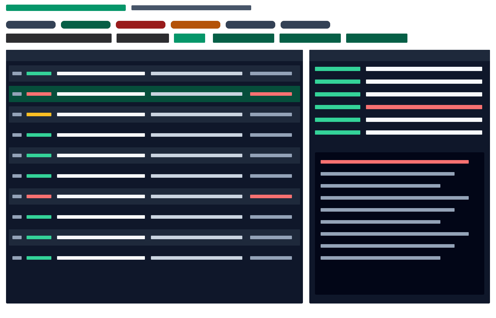

# JUnit XML Test Report Viewer for VS Code

Inspect `junit.xml`, `*.junit.xml`, `test-results.xml`, `TEST-*.xml` and `surefire-*.xml` test reports right in VS Code without uploading artifacts or connecting to a CI server. CI test runs often produce thousands of lines of XML across Maven Surefire, Gradle, pytest, Jest, Vitest and Go where failing assertions, slow tests and flaky reruns are hard to read as raw markup. This extension parses JUnit XML locally in plain JavaScript with zero CI or cloud calls.

## What it opens

- `junit.xml`, `*.junit.xml`, `test-results.xml`, `TEST-*.xml` and `surefire-*.xml` files.
- Any open JUnit XML file via the Command Palette or Explorer context menu (Open in JUnit XML Test Report Viewer).
- Nothing to install, no CI server connection required, nothing uploaded.

## The free part

- Testsuite and testcase explorer: shows pass, fail, error, flaky and skip counts across all suites in one filterable table.
- Slowest tests leaderboard: ranks the slowest test cases by duration so performance bottlenecks stand out immediately.
- Stack-trace drawer: click any failing, errored or flaky test case to inspect its failure message, stack trace, `system-out` and `system-err`.
- Flaky and skipped filters: filter by failed, errored, flaky rerun, skipped or slow tests without editing the XML file.

## The Pro tools, with 1 free try

Pro adds the triage, diff and export steps: generate a Markdown failure and slow-test triage report for one report or a folder, compare two JUnit XML runs in Markdown for new failures, fixed tests and duration regressions, or export a CSV test duration and status inventory plus Markdown summary locally. Your first try of each Pro tool is free. Zovo Pro is USD 19 once, and the team licence is USD 59.

## Why not plain text

Reading a 10,000-line `surefire-*.xml` file as raw text hides which tests failed, which ones took 6 seconds, and which ones only passed after a rerun. A local viewer puts pass/fail counts, the slowest tests leaderboard and full stack traces on one screen.

## More tools by Zovo

See full docs and install options at [vscode.zovo.one/extensions/zovo-junit-report-viewer/](https://vscode.zovo.one/extensions/zovo-junit-report-viewer/), browse all Zovo VS Code extensions at [vscode.zovo.one](https://vscode.zovo.one/), or explore [Zovo Pro](https://vscode.zovo.one/pro/).
